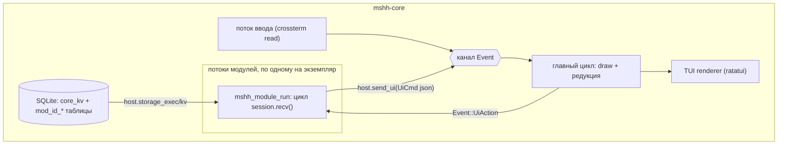

# Архитектура MSHH

Ядро — «операционная система» мессенджера: рендеринг, хранилище, ввод, запуск
модулей. Протоколов в ядре нет: бесполезно без модулей по задумке.

## Потоки и данные

* **Главный цикл** владеет `App` (состояние оболочки) и перерисовывается по
  таймауту/событиям канала `Event`.
* **Поток модуля** полностью свой: модуль волен блокироваться и спать. Ядро и
  UI при этом не блокируются: `send_ui` и события — через каналы.
* **`Session` не `Send`**: обращение к host-функциям допустимо только из потока
  `run`, пока ядро владеет экземпляром. Иначе после `destroy` возникали бы
  висячие указатели на vtable. Собственные потоки модуля общаются с `run`
  через свои каналы.
* Хранилище: один SQLite (WAL), доступ под мьютексом. Таблицы модуля обязаны
  иметь префикс `mod_<id>_`; KV ядра изолирован по id модуля.

## ABI v1 (mshh-module-api)

Модуль — `cdylib`. Экспорты (генерирует макрос `register_module!`):

| Символ | Смысл |
|---|---|
| `mshh_abi_version` | версия ABI; при несовпадении ядро не грузит модуль |
| `mshh_module_info` | статический `MshhModuleInfo { id, name, version }` |
| `mshh_module_start(host) -> handle` | создаёт экземпляр (один на библиотеку) |
| `mshh_module_run(handle)` | блокирует поток: главный цикл модуля |
| `mshh_module_event_sink(handle, json) -> rc` | ядро кладёт `Ev` в очередь (thread-safe) |
| `mshh_module_destroy(handle)` | освобождает экземпляр (после завершения `run`) |

Host-vtable (ядро → модуль): `log`, `send_ui`, `storage_exec`, `kv_get`,
`kv_set`, `now_ms`, `free`.

Правила памяти: все `MshhStr`/`MshhBuf` валидны на время вызова; буферы,
выделенные ядром (`libc::malloc`), модуль освобождает через `vtable.free`;
ядро копирует всё полученное до выхода из вызова. Все тела FFI-функций обеих
сторон обёрнуты в `catch_unwind`.

Владение host-состоянием: `Arc<HostState>` принадлежит `ModuleInstance`
(FFI-пойнтер с явным владельцем). `destroy` → `Arc` освобождается. Если модуль
не завершился по таймауту, `Arc` переезжает в graveyard runtime'а — без утечек
на нормальном пути и без UB на зомби-пути.

Формат данных через ABI — JSON (`serde`-типы `Ev`/`UiCmd`/`SqlValue`). Изменение
представления этих типов = новое значение `ABI_VERSION`. JSON выбран для
отладочной простоты каркаса; при необходимости заменяется на бинарный формат без
изменения границ ABI (но с поднятием версии).

## Отображение

Модуль описывает **что** показывать (`UiCmd::SetChats`, `AddMessage`,
`PromptLogin`, `Toast`…), ядро решает **как**. Оболочка фиксирована:
аккаунты/чаты слева, история и композер справа, форма входа — оверлей
(поля формы определяет модуль). Действия пользователя возвращаются модулю как
`Ev::UiAction` со стандартными именами (`__chat.open`, `__composer.send`,
`__login.submit`, `__login.cancel`) или собственными из `PromptLogin`.

TUI — первый рендерер. Планируемый GUI-рендерер будет потреблять те же `UiCmd`
и то же `App`; для модулей ничего не меняется. `Body::Image`/`File` в TUI —
плейсхолдеры, в GUI — реальные медиа.

## Модель доверия

Модуль = нативный код = полный доступ к процессу и профилю пользователя
(как мод игры). Ядро не изолирует модули: это сознательное решение каркаса —
сначала простота и мощь SDK. Изоляция (WASM-песочница или плагины-процессы по
IPC) — возможное направление v2; границы ABI уже позволяют заменить транспорт.

## Дорожная карта

1. **Windows/Android**: расширение `.so/.dll/.dylib` уже выбирается `cfg`
   (`loader::lib_ext`); останется сборка тулчейном под платформу и пути XDG →
   `%APPDATA%`/Android storage.
2. **Сеть в ABI v2**: host-примитивы `tcp/tls/ws` в vtable (сейчас модуль
   тянет свои крейты: tokio/rustls — это работает и разрешено).
3. **GUI-рендерер** поверх того же состояния.
4. **Мульти-экземпляры** одной библиотеки (несколько аккаунтов одного
   протокола) — сейчас один экземпляр на .so.
